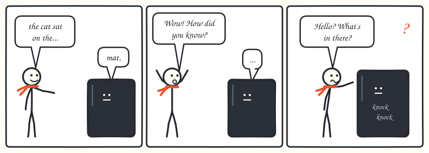
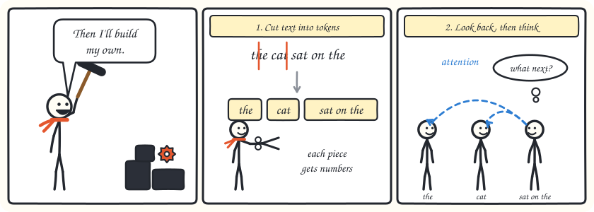
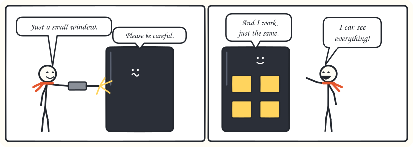
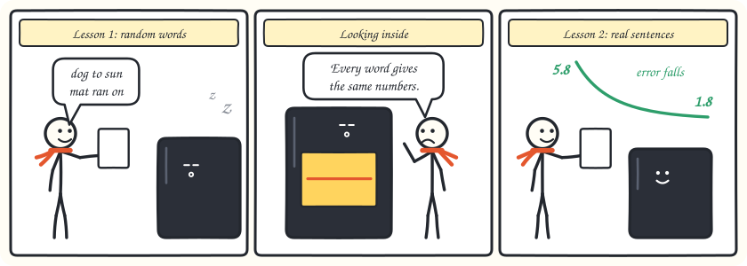
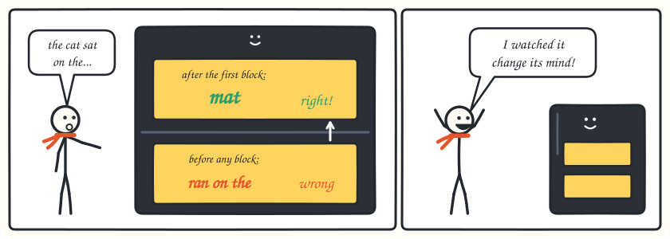
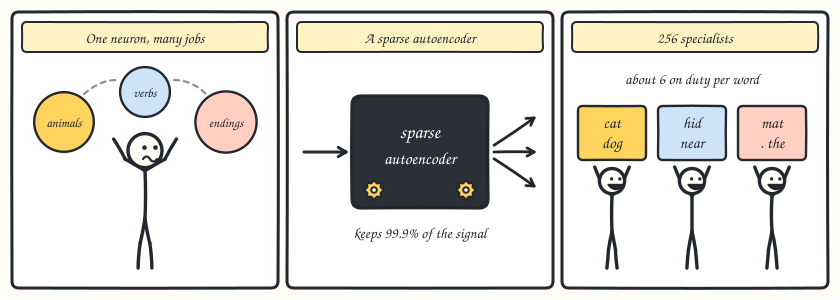
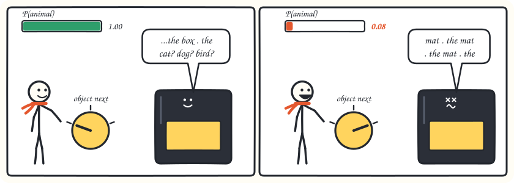
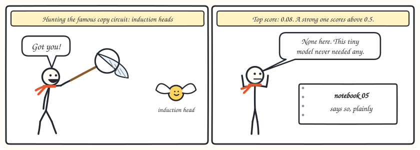
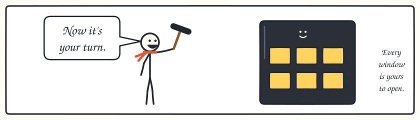

<div align="center">

# KAMUI

### Knowledge Activation Mapping & Understanding Interface

**A language model you build yourself, then open up to see how it thinks.**

*"To understand a model, you must first see what it sees."*

[](https://github.com/RithvikReddy0-0/KAMUI/actions/workflows/ci.yml)
[](https://rithvikreddy0-0.github.io/KAMUI)
[](https://github.com/RithvikReddy0-0/KAMUI/releases)
[](https://www.python.org/downloads/)
[](LICENSE)
[](https://github.com/psf/black)

[The story](#the-story-of-kam-and-the-box) •
[Quickstart](#quickstart) •
[Toolkit](#the-toolkit) •
[Notebooks](#notebooks) •
[Documentation](https://rithvikreddy0-0.github.io/KAMUI) •
[Contributing](CONTRIBUTING.md)

</div>

---

KAMUI is a transformer language model and a set of interpretability tools,
**written from scratch** in PyTorch. There's no HuggingFace Trainer and no
PyTorch Lightning. You train the model yourself, then use the tools to watch it
think, find out which parts cause which behaviour, and change what it does.

It's for researchers and students who want to understand how language models
work, not only use them. The best way to see what that means is a short story.
Short on time? Skip to the [Quickstart](#quickstart).

---

## The story of Kam and the Box

This all really happened, in the tiny model the [notebooks](notebooks/) train
in under a minute on a CPU. The numbers come from those runs, so you can
reproduce them yourself (they may vary slightly from machine to machine). CI runs
the Quickstart and checks each chapter's claims, so the story can't quietly go
out of date.

### Chapter 1: The Box



Kam meets a Box that finishes sentences. Say *"the cat sat on the"* and it
answers *"mat"*. Ask how it knew, and it says nothing.

That's a language model: confident answers, no explanation. You can poke it
from the outside, but someone else built it and someone else trained it, so
what happens inside stays a mystery.

### Chapter 2: Build your own



So Kam builds one, every part by hand. A tokenizer cuts text into pieces.
Embeddings turn the pieces into numbers. **Attention** lets each piece look back
at the ones before it, and a **feed-forward** layer lets it think on its own.
Stack those into blocks, add a training loop you can read top to bottom, and
you have a language model with nothing hidden in it.

> **In the code:** `BPETokenizer` · `KAMUITransformer` · `Trainer` · notebooks [00](notebooks/00_bpe_tokenizer.ipynb), [01](notebooks/01_attention_mechanics.ipynb), [02](notebooks/02_training_dynamics.ipynb)

### Chapter 3: Cut windows



A model you built is still dark while it runs, so Kam cuts windows. Each window
is a **hook**: it reads one activation, at any point in the model, during a
forward pass. When the run ends the hooks come out, and the model's output
hasn't changed at all.

> **In the code:** `HookManager`

### Chapter 4: Nothing to see



Kam's first lesson is a list of random words. Then Kam looks through a window
and finds almost nothing: at the second feed-forward layer, the reading is
about 12.87 in size and shifts by only 0.01 from word to word. Random words have
no pattern except how common each word is, so that's all the Box learned, and
the error stalled at 3.2.

The second lesson uses real sentences: *the ANIMAL VERB PREP the OBJECT.* Now the
next word depends on what came before. The error falls from 5.8 to 1.8, and the
windows come alive.

A model can only show you what it learned.

### Chapter 5: Watch a thought form



Kam asks the old question again, and this time reads the Box's guess at each
stage, as if it had to answer right there. Before any block it guesses a verb
phrase, *"ran on the"*. After the first block it says *"mat"*.

For the first time, Kam can see the answer forming. This is the **logit lens**.

> **In the code:** `LogitLens` · [notebook 03](notebooks/03_logit_lens.ipynb)

### Chapter 6: The detective


Seeing *when* isn't the same as knowing *why*, so Kam turns detective. Take one
prompt where an object should come next and one where an animal should. Move
one part at a time from the first run into the second, and see how much of the
right answer comes back. This is **activation patching**.

Attention brings back about 0%. The first block's feed-forward layer brings back
99.5%.

One test could be a fluke, so Kam tries a different one: **ablation**, which
removes a part completely. Taking out that same layer drops the score for
*"mat"* by 10 points, while removing anything else costs less than 0.3. Two
different tests, same culprit.

> **In the code:** `ActivationPatcher` · `CircuitAblator` · notebooks [04](notebooks/04_activation_patching.ipynb), [06](notebooks/06_circuit_analysis.ipynb)

### Chapter 7: Too many jobs



Looking at single neurons gets Kam nowhere, because one neuron does several jobs
at once. Models hold more ideas than they have neurons, a problem called
*superposition*.

So Kam trains a **sparse autoencoder** to split the work among 256 specialists.
Only about 6 work on any given word, and about a quarter never get used at all,
yet together they keep 99.9% of the signal. Nobody told it about grammar, but the
specialists it finds are readable: one fires on animals, one on verb phrases, one
on sentence endings.

> **In the code:** `SparseAutoencoder` · `interpret_features` · `max_activating_examples` · `feature_cooccurrence` · `feature_similarity` · [notebook 07](notebooks/07_sparse_autoencoders.ipynb)

### Chapter 8: Turn the dial



Reading a feature is only a hypothesis. To test it, you intervene.

Verb phrases are always followed by an object, and sentence endings by an animal,
so comparing their activations gives Kam a direction that means *"an object comes
next"*. At a point where an animal must come next, the Box is certain:
P(animal) = 1.00. Kam adds the direction, like turning a dial. P(animal) falls to
0.08, and the Box starts writing *"the mat . the mat . the mat"*.

If you turn something and the behaviour changes, you've found something real.
This is **steering**. Its opposite, **feature ablation**, removes a feature to
see whether the model was using it.

> **In the code:** `FeatureSteerer` · `build_steering_vector` · [notebook 07](notebooks/07_sparse_autoencoders.ipynb)

### Chapter 9: The one that got away



Not every hunt ends in a catch. **Induction heads** are a famous circuit that lets
models copy patterns they've just seen. Kam's detector gives its best head a score
of 0.08, and a strong one scores above 0.5. This tiny model trained for seconds on
text where copying rarely helps, so it never needed any.

The notebook says so plainly. A tool that can tell you "nothing here" is as
valuable as one that finds something. Kam is still hunting.

> **In the code:** `InductionHeadDetector` · [notebook 05](notebooks/05_induction_heads.ipynb)

### Chapter 10: Your turn



That's the whole method: build it, open it, test it. Everything Kam did is in this
repo, and the [Quickstart](#quickstart) below repeats most of the story on your
own machine.

---

## Quickstart

```bash
git clone https://github.com/RithvikReddy0-0/KAMUI
cd KAMUI
pip install -e ".[all]"
```

**Build the Box.** This is the same tiny model as the story, and it trains in under
a minute on a CPU:

```python
import random

import torch

import kamui
from kamui.training import DataLoader, TextDataset

torch.manual_seed(0)
rng = random.Random(0)

# Sentences with real grammar: "the ANIMAL VERB PREP the OBJECT ."
animals, verbs = ["cat", "dog", "bird", "fish"], ["sat", "ran", "slept", "hid"]
preps, objects = ["on", "under", "near"], ["mat", "log", "rug", "box"]
corpus = " ".join(
    f"the {rng.choice(animals)} {rng.choice(verbs)} {rng.choice(preps)} the {rng.choice(objects)} ."
    for _ in range(700)
)

config = kamui.ModelConfig(n_layers=2, d_model=64, n_heads=4, d_ff=128,
                           vocab_size=320, context_length=32)
tokenizer = kamui.BPETokenizer.train(corpus, vocab_size=config.vocab_size)
tokens = tokenizer.encode(corpus)

model = kamui.KAMUITransformer(config)
trainer = kamui.Trainer(
    model,
    DataLoader(TextDataset(tokens, config.context_length), batch_size=8, seed=0),
    config=kamui.TrainingConfig(max_lr=3e-3, warmup_steps=10, max_steps=1000),
)
trainer.train(200)
model.eval()
```

**Watch a thought form** (chapter 5):

```python
ids = torch.tensor(tokenizer.encode("the cat sat on the "))
result = kamui.LogitLens(model, tokenizer).run(ids)
for layer in range(result.probs.shape[0]):
    print(layer, repr(tokenizer.decode([result.probs[layer, -1].argmax().item()])))
# 0 'ran on the '
# 1 'mat . the '
# 2 'mat . the '
```

**Find the part that decides** (chapter 6):

```python
corrupted = torch.tensor(tokenizer.encode("the cat mat . the "))
patcher = kamui.ActivationPatcher(model)
print(patcher.patch_all_layers(ids, corrupted, component="ffn").effects)
# tensor([0.9948, 0.0767]): the first block's feed-forward brings the answer back
```

**Split the neurons into specialists** (chapter 7):

```python
from kamui.mechinterp import collect_activations, interpret_features, train_sae

hook = "blocks.1.ffn.output"
seqs = [torch.tensor(tokens[i : i + 32]) for i in range(0, 40 * 32, 32)]
acts = collect_activations(model, hook, seqs)  # one row per token

sae = kamui.SparseAutoencoder(d_model=64, n_features=256, l1_coeff=1.0)
train_sae(sae, acts, epochs=60, lr=3e-3, batch_size=256)

profiles = interpret_features(sae, acts, torch.cat(seqs), top_k=8)
selective = [p for p in profiles if p.top_token_ids and p.density <= 0.5]
for p in sorted(selective, key=lambda p: p.mean_activation, reverse=True)[:5]:
    print(sorted({tokenizer.decode([i]) for i in p.top_token_ids}))
```

**Turn the dial** (chapter 8):

```python
from kamui.mechinterp import FeatureSteerer, build_steering_vector

words = {t: tokenizer.decode([t]) for t in set(tokens)}
starts = lambda t, group: (words[t].split() or [""])[0] in group

direction = build_steering_vector(
    model, hook,
    positive=[torch.tensor([t]) for t in words if starts(t, verbs) and words[t].endswith("the ")],
    negative=[torch.tensor([t]) for t in words if starts(t, objects) and words[t].endswith(". the ")],
)
print(FeatureSteerer(model).generate_steered(
    tokenizer, "the bird hid near the box . the ", hook, direction,
    coefficient=4.0, max_new_tokens=6, use_cache=True,
))
# the bird hid near the box . the mat . the mat . the mat . the mat . the mat . the mat . the
```

**Going further.** Train on your own text with `kamui-train --config configs/nano.yaml
--corpus your_text.txt`. A LLaMA-style model (rotary positions and RMSNorm) is one
config change away:

```python
import dataclasses

base = kamui.ModelConfig.from_yaml("configs/nano.yaml")
llama_style = dataclasses.replace(base, positional_encoding="rope", normalization="rmsnorm")
```

---

## The toolkit

**Components and circuits**

| Tool | What it answers |
|------|----------------|
| `AttentionVisualizer` | What is each attention head attending to? |
| `LogitLens` | At each layer, what token does the model predict? |
| `LinearProbe` | At each layer, what linguistic properties are encoded? |
| `ActivationPatcher` | Which components are *causally* responsible for a behaviour? |
| `InductionHeadDetector` | Which heads implement in-context pattern matching? |
| `CircuitAblator` | What is the minimal circuit for a behaviour? |
| `GradientAttribution` | Which input tokens drove this prediction? |

**Features and superposition** (in `kamui.mechinterp`)

| Tool | What it answers |
|------|----------------|
| `SparseAutoencoder` + `train_sae` | What features is this layer representing? (save / load included) |
| `interpret_features` | Which tokens make each feature fire? |
| `max_activating_examples` | In what contexts does a feature fire most strongly? |
| `feature_cooccurrence` | Which features fire together? |
| `feature_similarity` | Which features point in the same direction? |
| `FeatureSteerer.steer` / `generate_steered` | What happens if I push the model along a feature? |
| `FeatureSteerer.ablate_features` | Does the model actually *use* this feature? |
| `build_steering_vector` | What direction separates two sets of prompts? |

**Training and evaluation**

| Piece | What it does |
|-------|--------------|
| `Trainer` / `TrainingConfig` | Explicit loop: gradient accumulation, clipping, cosine LR with warmup |
| `kamui.training.distributed` | Data parallelism (DDP), verified with two real CPU processes. GPUs aren't supported yet |
| `kamui.training.EMA` | Exponential moving average of the weights for evaluation / sampling |
| `model.set_gradient_checkpointing(True)` | Recompute block activations in backward: ~17x less activation memory for ~14% more time |
| `compute_perplexity` / `compute_accuracy` | Perplexity and top-k next-token accuracy |
| `expected_calibration_error` | Does the model's confidence match its accuracy? |
| `generate` | Greedy / top-k / nucleus / temperature sampling, repetition penalty, stop tokens, optional KV-cache (`use_cache=True`) |

---

## Notebooks

Eight notebooks walk through the story in detail. CI runs every one of them, so
they keep working as the code changes.

| Notebook | What you learn |
|----------|----------------|
| [`00_bpe_tokenizer`](notebooks/00_bpe_tokenizer.ipynb) | Build BPE tokenisation from first principles |
| [`01_attention_mechanics`](notebooks/01_attention_mechanics.ipynb) | Visualise attention in a 2-layer model |
| [`02_training_dynamics`](notebooks/02_training_dynamics.ipynb) | Loss curves, gradient norms, LR schedules |
| [`03_logit_lens`](notebooks/03_logit_lens.ipynb) | Watch predictions evolve layer by layer |
| [`04_activation_patching`](notebooks/04_activation_patching.ipynb) | Causal interventions: find which part decides |
| [`05_induction_heads`](notebooks/05_induction_heads.ipynb) | Detect and ablate induction circuits |
| [`06_circuit_analysis`](notebooks/06_circuit_analysis.ipynb) | Reverse-engineer a complete behaviour |
| [`07_sparse_autoencoders`](notebooks/07_sparse_autoencoders.ipynb) | Train an SAE, read its features, then steer and ablate them |

---

## Under the hood

KAMUI is organised into five layers with a strict one-direction dependency:

```
tokenizer  →  model  →  hooks  →  mechinterp  →  evaluate
```

```
text input
    ↓  BPETokenizer (from scratch, no tiktoken)
token_ids  (B, S)
    ↓  Embedding: token (+ learned / sinusoidal positions; RoPE acts inside attention)
residual_stream  (B, S, D)
    ↓  × n_layers:
       Pre-norm → MultiHeadAttention → residual add
       Pre-norm → FeedForward        → residual add
residual_stream  (B, S, D)
    ↓  Final norm → Linear unembedding (weight-tied)
logits  (B, S, V)

norm = LayerNorm (default) or RMSNorm, set by ModelConfig.normalization

HookManager captures any activation above ↑
mechinterp tools use captured activations for analysis
```

KAMUI also includes research tooling. Every experiment can be reproduced from its
own folder, and the research log becomes the experiments section of your paper:

```
research/
├── experiments/        # one folder per experiment (config + results + notes)
├── reports/            # written findings and paper drafts
├── figures/            # publication-quality plots
├── future/             # design specs (e.g. the SAE spec, now implemented)
└── RESEARCH_LOG.md     # chronological experiment log
```

---

## Installation

KAMUI isn't on PyPI yet, so install it from source:

```bash
# Minimal install (training + inference), pinned to a release
pip install "git+https://github.com/RithvikReddy0-0/KAMUI.git@v0.4.0"

# With visualisation extras (matplotlib, plotly)
pip install "kamui[viz] @ git+https://github.com/RithvikReddy0-0/KAMUI.git@v0.4.0"

# Full development install
git clone https://github.com/RithvikReddy0-0/KAMUI
cd KAMUI
pip install -e ".[all]"
pre-commit install
```

**Requirements**: Python 3.11+, PyTorch 2.1+

---

## Roadmap

| Version | Scope | Status |
|---------|-------|--------|
| **v0.1** | Core transformer + 6 interpretability tools | ✅ Released |
| **v0.2** | Sparse autoencoders, gradient attribution, RoPE | ✅ Released |
| **v0.3** | Distributed data parallelism (DDP), on CPU processes | ✅ Released |
| **v0.4** | SAE feature analysis & steering, RMSNorm, weight EMA, decoding controls, accuracy metric, KV-cache, gradient checkpointing | ✅ Released |

See [CHANGELOG.md](CHANGELOG.md) for the full history, and the
[issue tracker](https://github.com/RithvikReddy0-0/KAMUI/issues) for what's being
worked on.

<details>
<summary><b>Build log:</b> every piece, in the order it was built</summary>

```
Repository Foundation    ██████████  ✅ complete
ModelConfig System       ██████████  ✅ complete
Vocabulary System        ██████████  ✅ complete
BPE Tokenizer            ██████████  ✅ complete
Embeddings               ██████████  ✅ complete
LayerNorm                ██████████  ✅ complete
FeedForward Network      ██████████  ✅ complete
Attention Mechanism      ██████████  ✅ complete
Transformer Block        ██████████  ✅ complete
Transformer Architecture ██████████  ✅ complete
Training Pipeline        ██████████  ✅ complete
Hook System              ██████████  ✅ complete
Evaluation (ppl + gen)   ██████████  ✅ complete
Calibration Metrics      ██████████  ✅ complete
Attention Visualizer     ██████████  ✅ complete
Logit Lens               ██████████  ✅ complete
Linear Probing           ██████████  ✅ complete
Activation Patching      ██████████  ✅ complete
Induction Head Detector  ██████████  ✅ complete
Circuit Ablation         ██████████  ✅ complete
Shared Utilities         ██████████  ✅ complete
── v0.2 ─────────────────────────────────────────
RoPE Positional Encoding ██████████  ✅ complete
Gradient Attribution     ██████████  ✅ complete
Sparse Autoencoders      ██████████  ✅ complete
── v0.3 ─────────────────────────────────────────
DDP on CPU Processes     ██████████  ✅ complete
── v0.4 ─────────────────────────────────────────
SAE Feature Analysis     ██████████  ✅ complete
Steering & Ablation      ██████████  ✅ complete
RMSNorm Option           ██████████  ✅ complete
Weight EMA               ██████████  ✅ complete
Decoding Controls        ██████████  ✅ complete
Accuracy Metric          ██████████  ✅ complete
KV-Cache Generation      ██████████  ✅ complete
Gradient Checkpointing   ██████████  ✅ complete
```

The suite has 979 tests at ~99% coverage, with `ruff`, `black`, and `mypy` all clean.

</details>

---

## Contributing

KAMUI is an open research project. See [CONTRIBUTING.md](CONTRIBUTING.md).

The easiest first contribution is a new interpretability tool in
`kamui/mechinterp/`. The hook system handles capturing activations, so you only
write the analysis.

Find open issues on [GitHub Issues](https://github.com/RithvikReddy0-0/KAMUI/issues).

---

## Why this exists

> Interpretability is not a feature. It is the prerequisite for trust.

We can't trust systems we can't understand. KAMUI is a tool for building that
understanding, one component, one circuit, one forward pass at a time.

It stands on the shoulders of:

- [nanoGPT](https://github.com/karpathy/nanoGPT): Andrej Karpathy's minimal GPT implementation
- [TransformerLens](https://github.com/neelnanda-io/TransformerLens): Neel Nanda's interpretability library
- [Anthropic Interpretability Research](https://transformer-circuits.pub): the circuits thread

nanoGPT shows how to build a model, and TransformerLens gives you tools to study
one. KAMUI puts both jobs in a single codebase you can read from end to end.

---

## Citation

If you use KAMUI in research, please cite:

```bibtex
@software{mukkara2026kamui,
  author    = {Mukkara, Rithvik Reddy},
  title     = {{KAMUI}: {K}nowledge {A}ctivation {M}apping \& {U}nderstanding {I}nterface},
  year      = {2026},
  publisher = {GitHub},
  url       = {https://github.com/RithvikReddy0-0/KAMUI},
  license   = {MIT},
}
```

---

## License

MIT, see [LICENSE](LICENSE).

---

<div align="center">
Built by <a href="https://github.com/RithvikReddy0-0">Rithvik Reddy Mukkara</a>
<br>
Amrita Vishwa Vidyapeetham · CSE · 2027
</div>
